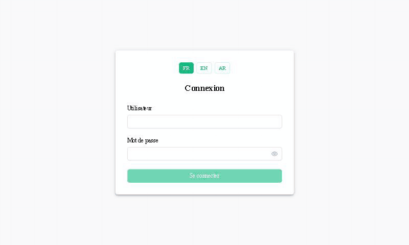
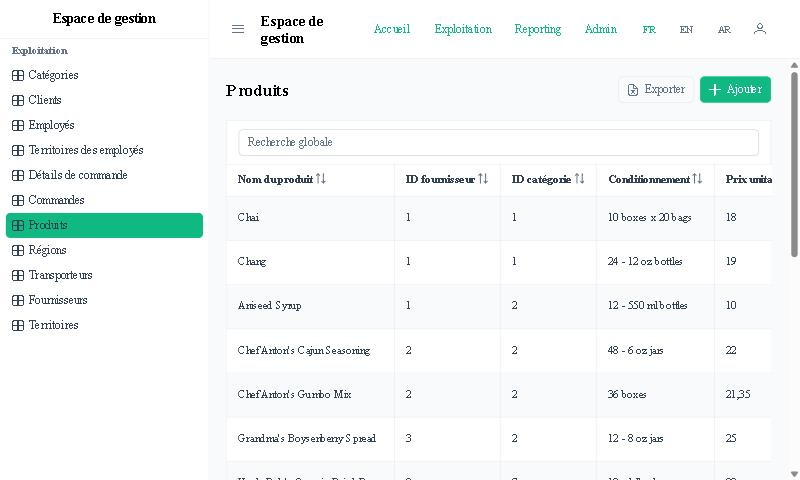
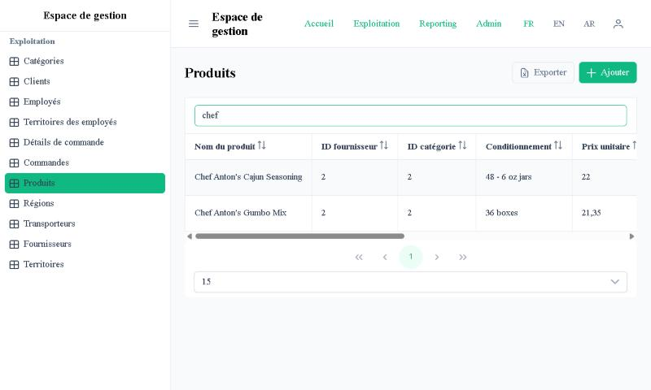
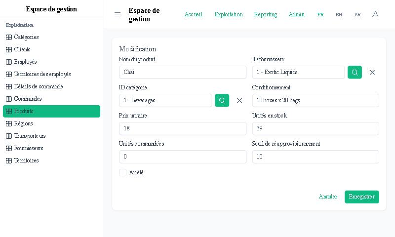
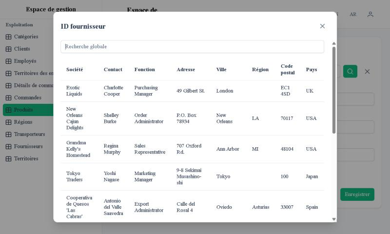
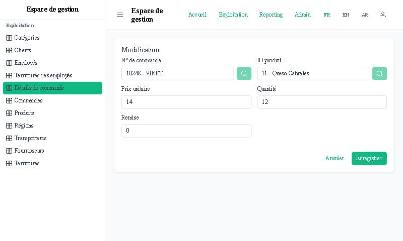
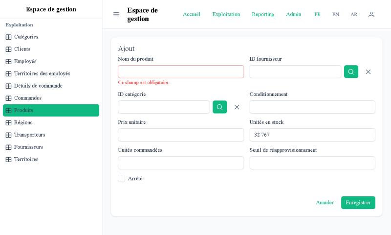
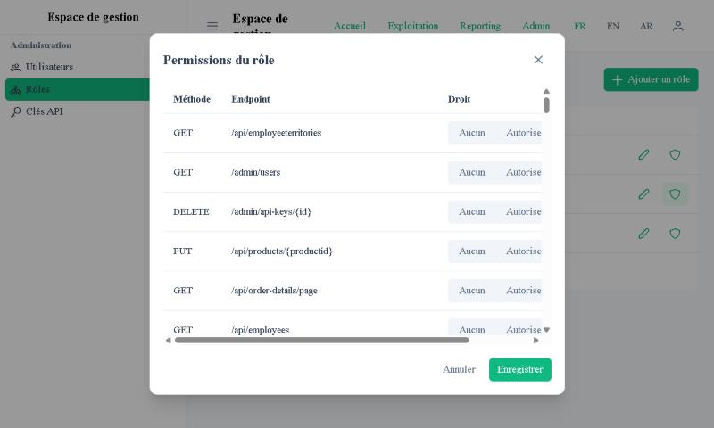
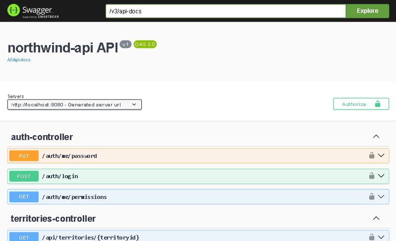
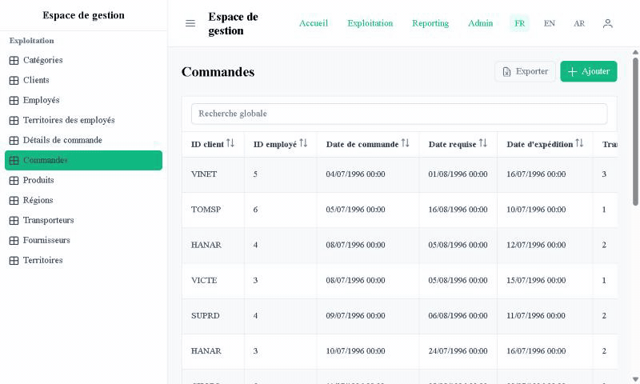

# Northwind CRUD Demo — Spring Boot + Angular generated from a SQL Server schema

A complete, working admin application (REST API + web UI) for the classic **Northwind** sample database.
It was produced by my in-house **SQL Server → Spring Boot + Angular CRUD generator**, which reads a schema
through JDBC metadata and emits a ready-to-run full-stack project, so none of the repetitive CRUD
plumbing has to be written by hand.



## What you get

**Back end — Spring Boot 3.3 / Java 21**
- REST endpoints for 11 tables and 1 read-only view (`GET`, `POST`, `PUT`, `DELETE`, plus a paged endpoint)
- Server-side pagination, sorting and global "contains" search
- Composite primary keys (`Order Details`, `EmployeeTerritories`) handled with `@IdClass`
- Bean Validation rules derived from the column metadata (`NOT NULL`, lengths, numeric ranges)
- Consistent error responses (RFC 7807 `ProblemDetail`): 400 with per-field details, 404, 409 on integrity violations
- JWT login **and** API-key authentication, role-based permissions per endpoint, deny-by-default
- OpenAPI documentation with Swagger UI

**Front end — Angular 21 / PrimeNG 21**
- Lazy-loaded paginated tables wired to the server-side endpoints, Excel export
- Add / edit forms with validation that mirrors the database constraints
- Foreign-key lookup dialogs (searchable, paginated) with the referenced label displayed in the form
- French / English / Arabic interface with right-to-left layout
- Administration screens: users, roles, per-endpoint permissions, API keys

## Screenshots

| | |
|---|---|
|  |  |
|  |  |
|  |  |
|  |  |

Language switching, including right-to-left Arabic:



## Run it locally

Requirements: JDK 21, Maven, a Node.js version supported by Angular 21, SQL Server (TCP/IP enabled on port 1433, SQL authentication enabled).

**1. Create the Northwind database**

Download Microsoft's `instnwnd.sql` from the
[sql-server-samples](https://github.com/microsoft/sql-server-samples/tree/master/samples/databases/northwind-pubs)
repository (the data set is not redistributed here), then:

```sql
CREATE DATABASE Northwind;
```

```bash
sqlcmd -S localhost -E -d Northwind -i instnwnd.sql
```

**2. Create a SQL login limited to that database** (choose your own password)

```sql
CREATE LOGIN northwind_demo WITH PASSWORD = '<choose-a-password>';
USE Northwind;
CREATE USER northwind_demo FOR LOGIN northwind_demo;
ALTER ROLE db_owner ADD MEMBER northwind_demo;
```

**3. Encrypt the password for the API**

The generated API never stores the database password in clear text: it is AES-encrypted with a key
taken from the `DB_SECRET_KEY` environment variable.

```bash
cd api
mvn -q compile
export DB_SECRET_KEY="<a-long-random-string>"
java -cp target/classes com.example.northwind.config.PasswordCipherTool "<choose-a-password>"
```

Put the printed value in `src/main/resources/application-dev.properties` as
`app.datasource.password-encrypted`, or export it as `APP_DATASOURCE_PASSWORD_ENCRYPTED`.
On Windows, use PowerShell rather than Git Bash for the environment variables: Git Bash rewrites values
that start with `/`.

**4. Start the API** (keep `DB_SECRET_KEY` exported in the same shell)

```bash
mvn spring-boot:run
```

Swagger UI: http://localhost:8080/swagger-ui.html

**5. Start the UI**

```bash
cd ../ui
npm install
npm start
```

Open http://localhost:4200 and sign in with `admin` / `admin`.

Optional environment variables: `JWT_SECRET` (signing key) and `ADMIN_PASSWORD` (bootstrap admin password).
The default `admin` account exists for this demo only.

## Adjusted after generation

The project is the generator's output with a few manual changes, listed here for transparency:

- Disabled Spring Boot's camelCase → snake_case column renaming (`PhysicalNamingStrategyStandardImpl`),
  because Northwind columns are PascalCase (`CategoryName`) and the entities already name every column explicitly.
- Edit forms load their record in `ngOnInit()` instead of the constructor, so the route parameters are available.
- Typed the form group as `FormGroup<Record<string, FormControl<any>>>` so foreign-key lookups compile.
- Hand-written French and English labels for tables and columns (the generator produces humanised names)
  and translated sidebar entries. Arabic column headers are still the English labels.
- Moved the JWT secret and the bootstrap admin password to environment variables with demo defaults.

## About this repository

This is a demo of generated code, not a production deployment: the demo credentials, the default JWT secret
and the permissive `trustServerCertificate=true` JDBC option must be replaced for any real use.
Northwind is a Microsoft sample database; its data is not included in this repository.
